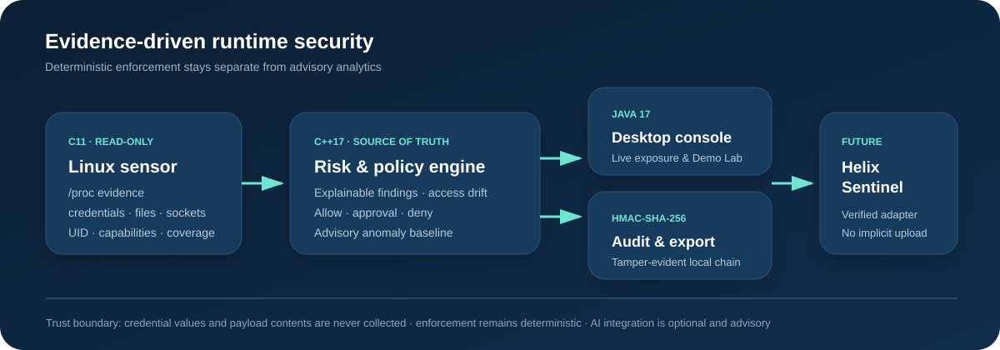

# AgentShield

[](https://github.com/joaosalero/agentshield/actions/workflows/ci.yml)
[](LICENSE)


**A privacy-first runtime security console for AI agents.** AgentShield shows
credential-like environment names, effective privileges, and security-relevant
open files and sockets observed for a running agent. It highlights dangerous
changes and explains what deserves attention.



> Portfolio-ready Linux/WSL preview. AgentShield is an observability and
> supervised-execution control—not a claim of complete operating-system
> isolation.

## Why it matters

AI agents can inherit access from their host process, while that effective
access remains scattered across environment variables, Linux capabilities,
open files, sockets, and policy decisions. AgentShield turns those signals into
one live, explainable view without collecting credential values.

## Product experience

- **Live exposure inventory:** credential names, privileges, sensitive files,
  sockets, and monitoring coverage.
- **Access-drift timeline:** clearly distinguishes grants, revocations, and lost
  visibility between snapshots.
- **Explainable risk:** every finding includes severity, evidence, score, and a
  remediation path.
- **Policy supervision:** versioned allow, deny, and approval rules can block a
  launch before the protected process starts.
- **Tamper-evident evidence:** authenticated HMAC-SHA-256 audit chains support
  offline verification and privacy-filtered export.
- **Behavior analytics:** a bounded, in-memory baseline detects unusual access
  patterns as advisory findings; it never silently changes security decisions.
- **Operational integration:** versioned readiness diagnostics, aggregate
  Prometheus metrics, and content-addressed policy pinning support controlled
  enterprise workflows without adding a network listener.

## Try the Demo Lab

### Build prerequisites

Build inside Linux or WSL2 with a C11/C++17 toolchain, GNU Make, Python 3,
OpenSSL 3 development headers, and JDK 17 or newer. On Ubuntu 24.04:

```bash
sudo apt update
sudo apt install build-essential cmake libssl-dev python3 openjdk-17-jdk git
git clone https://github.com/joaosalero/agentshield.git
cd agentshield
```

The desktop also needs a graphical session, such as WSLg on WSL2. Native
Windows and macOS sensors are not implemented; see the
[platform matrix](docs/PLATFORM_SUPPORT.md).

### Run the guided demo

The guided demo is the fastest way to understand the product. It progressively
simulates credential exposure, sensitive resource access, a policy decision,
and containment—all with labelled synthetic data. It never reads real secrets,
uses external connections, or mixes demo events with protected audit logs.

```bash
make
make java
make run-gui
```

Select **Launch Demo Lab** in the desktop console. JDK 17 is required for the
dashboard; the native monitor uses C11, C++17, Python 3, and OpenSSL 3 headers.

See the [captured policy decisions and native supervision demo](docs/PORTFOLIO_CASE_STUDY.md#reproduce-the-evidence)
for an actual desktop session and a separate Linux example that verifies a
strict-privacy audit before printing its result.

### Validate a local build

```bash
make test
make java-test
make portfolio-check
```

Run `make sanitize` for AddressSanitizer/UndefinedBehaviorSanitizer coverage.
The ordinary native suite can skip the positive cgroup integration path when
delegation is unavailable. Release qualification requires
`make cgroup-test-required` on a host with delegated cgroup v2; see
[validation evidence](docs/VALIDATION.md) for the conditions and historical
receipts. Passing the desktop or documentation checks alone does not validate
Linux process monitoring or containment.

## Technical depth

| Concern | Implementation | Evidence |
|---|---|---|
| Low-level observation | Read-only Linux `/proc` sensor in C11 with a stable, fixed-size ABI | [Security architecture](docs/SECURITY_ARCHITECTURE.md) |
| Risk and policy | C++17 rule engine, drift analysis, supervised launch, and JSONL/TSV contracts | [Policy guide](docs/POLICY.md) |
| Desktop experience | Java 17 Swing console with live metrics, risk tables, timeline, and Demo Lab | [Portfolio case study](docs/PORTFOLIO_CASE_STUDY.md) |
| Privacy | Credential values discarded during parsing; strict telemetry mode; no built-in network transmission | [Privacy guide](docs/PRIVACY.md) |
| Integrity | Owner-only keys/logs, append pre-verification, HMAC chain, fail-closed retention | [Audit guide](docs/AUDIT.md) |
| Supply chain | Pinned CI actions, CodeQL, deterministic archives, CycloneDX SBOM, and in-toto provenance | [Validation evidence](docs/VALIDATION.md) |

The native layer is intentionally split: the C sensor gathers bounded process
facts; the C++ engine owns interpretation, policy, and serialization. The Java
desktop consumes the same process-boundary contract that a future Helix
Sentinel integration can use.

## Inspect or supervise an agent

```bash
./build/agentshield inspect $$
./build/agentshield doctor
./build/agentshield inspect $$ --format prometheus
./build/agentshield watch 12345 --interval 1000
./build/agentshield run --privacy strict --max-memory-mb 2048 \
  --max-cpu-seconds 600 -- python3 your_agent.py
./build/agentshield run --policy policies/baseline.policy \
  --approve credential:MY_SCOPED_TOKEN -- python3 your_agent.py
```

For authenticated evidence:

```bash
./build/agentshield audit init-key audit.key
./build/agentshield watch 12345 --privacy strict \
  --audit audit.jsonl --audit-key audit.key
./build/agentshield audit verify audit.jsonl --audit-key audit.key
./build/agentshield audit export audit.jsonl --audit-key audit.key > helix.jsonl
```

The export contract is versioned as `io.helix-sentinel.agentshield/v1` and does
not transmit data by itself.

## Install and remove

```bash
cmake -S . -B build-release -DCMAKE_BUILD_TYPE=Release
cmake --build build-release --parallel
cpack --config build-release/CPackConfig.cmake -G DEB
sudo apt install ./agentshield_*.deb
```

The Debian package adds an application-menu entry, product icon, desktop
launcher, command-line executable, policies, documentation, and license.
Uninstall with `sudo apt remove agentshield`; user-created audits and policies
are preserved. See the [distribution guide](docs/DISTRIBUTION.md) for package
verification and alternative formats.

## Security boundaries

AgentShield reports **observed exposure**, not every permission available
through an external broker. The preview monitors same-user Linux processes.
Credential names come from `/proc/PID/environ`, which describes the environment
region established at exec; later `setenv`/`putenv` changes are not reliably
visible there. A credential-like name does not prove that its value is valid
or usable. See the [Linux interface documentation](https://man7.org/linux/man-pages/man5/proc_pid_environ.5.html).

Kernel settings, namespaces, `/proc` restrictions, and short-lived resources
can reduce visibility; loss of a monitoring surface is reported as uncertainty,
not mistaken for lower risk. A compromised kernel is outside the trust boundary.

Reports can contain local paths and must be handled as security telemetry. See
the [threat model](docs/THREAT_MODEL.md), [platform matrix](docs/PLATFORM_SUPPORT.md),
and [security policy](SECURITY.md) before operational use.

## Project evidence

- [Portfolio case study](docs/PORTFOLIO_CASE_STUDY.md) — product decisions,
  engineering trade-offs, and recruiter-oriented evidence.
- [Validation evidence](docs/VALIDATION.md) — tests, scope, and environmental
  limitations.
- [Behavior analytics](docs/BEHAVIOR_ANALYTICS.md) — anomaly metrics and the
  deliberate non-enforcement boundary.
- [AI and data-science strategy](docs/AI_AND_DATA_SCIENCE.md) — privacy-preserving
  path toward optional local intelligence.
- [Roadmap](docs/ROADMAP.md) — portfolio baseline and enterprise evolution.
- [Operations guide](docs/OPERATIONS.md) — readiness, privacy-safe metrics,
  alert semantics, and incident evidence.
- [Changelog](CHANGELOG.md) — notable project changes.

## Contributing and license

Contributions are welcome through [the contribution guide](CONTRIBUTING.md).
Security vulnerabilities should follow [the private reporting process](SECURITY.md).
AgentShield is available under the [MIT License](LICENSE).
