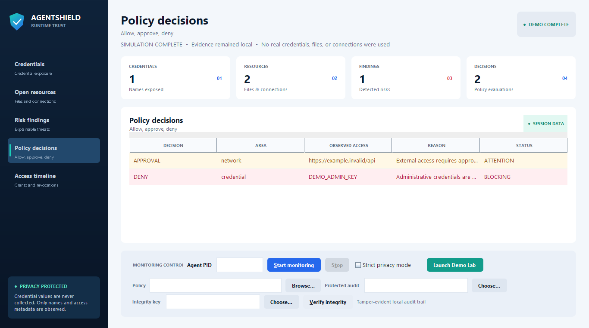

# AgentShield — engineering case study

## The problem

AI agents can inherit developer credentials, open files, network connections, and
Linux privileges that are invisible after launch. Traditional secret scanners find
values in code; sandbox products constrain execution. A separate observability
layer can explain which exposure signals are visible for a running process and
what changed since its prior snapshot, subject to the sensor's coverage limits.

## Product decision

AgentShield treats runtime access as explainable security evidence. It observes a
user-owned Linux process, normalizes access metadata, evaluates deterministic rules,
and presents the result through a desktop console or machine-readable stream. It is
deliberately an observability and policy control rather than a claim of perfect OS
mediation.

## Why three languages

| Layer | Language | Engineering rationale |
|---|---|---|
| Sensor | C11 | Small fixed-size ABI and direct, read-only `/proc` integration |
| Risk, policy, audit | C++17 | Typed domain model, deterministic evaluation, bounded serialization |
| Desktop console | Java 17 | Portable native desktop UI isolated across a process boundary |

The split is not cosmetic. The sensor cannot make policy decisions, the dashboard
cannot access credential values, and enforcement remains testable without the UI.

## Security decisions

- Credential values are discarded during parsing and are never retained or emitted.
- Missing observability creates a high-severity uncertainty finding instead of a
  misleading empty result.
- Supervised execution disables core dumps, closes inherited descriptors, applies
  `no_new_privs`, isolates process groups, and supports delegated cgroup limits.
- Policy is versioned and fail-closed; approvals exist only for one launch.
- Audit records form an HMAC-SHA-256 chain that is verified before append and before
  Helix export.
- Behavioral anomaly detection is in-memory and advisory. It contributes zero points
  to deterministic risk and cannot approve or block execution.

## Validation scope and evidence

The repository distinguishes configured checks from recorded historical results.
The latter are documented in [VALIDATION.md](VALIDATION.md) and have not been
independently reproduced for every host or revision.

| Evidence | Result |
|---|---|
| Native, desktop, and CodeQL checks | Configured in [CI](../.github/workflows/ci.yml) for pushes and pull requests to `main`; required-check enforcement is a separate repository setting |
| Sanitizer suite | Historical receipt in [VALIDATION.md](VALIDATION.md) records passing AddressSanitizer and UndefinedBehaviorSanitizer runs |
| Behavioral regression set | 2026-08-25 receipt: 0/140 synthetic normal false positives; 20/20 surges detected |
| Packaging | `make deterministic-package` and `make verify-deb` check byte-for-byte repackaging and package contents; they do not prove reproducible compilation |
| Kernel containment | 2026-08-22 receipt: delegated cgroup v2 integration passed without a skip on the documented WSL2 host |
| Supply chain | Build targets generate a CycloneDX source-input inventory and unsigned in-toto build metadata with bound SHA-256 checks; these are not a complete runtime SBOM or a signed attestation |

These results are bounded engineering evidence, not claims of production prevalence,
formal verification, or compliance certification.

## Product experience

The desktop console surfaces credential-name exposure, open resources, findings,
policy decisions, and an access timeline. A guided Demo Lab progressively demonstrates
a safe baseline, credential exposure, network approval, deterministic denial, and
containment using synthetic data and reserved destinations only.

## Reproduce the evidence



**Desktop session.** The image captures the Swing content pane after its
nine built-in events ran on JDK 21, compiled for Java 17. Select **Launch Demo
Lab**, then **Policy decisions**. The exercise shows one credential name, two
resources, one finding, and two decisions. The network request to
`example.invalid` and the credential denial are fixture events. These
decisions are rendered by the application without launching a monitored
process, contacting the destination, or writing an authenticated audit.

**Native Linux session.** From the repository root, run:

```bash
make
python3 scripts/demo_supervision.py build/agentshield
```

The [driver](../scripts/demo_supervision.py) starts a local shell with an
isolated environment containing a synthetic credential name. The shell waits
briefly and exits with status 7. The driver checks exit propagation, observes
a redacted credential name, verifies the audit chain with the native CLI, and
compares its record count to the emitted snapshots. It prints only aggregate
JSON. The number of records depends on scheduling. The temporary key, raw log,
and telemetry stay local. Verification uses the key created in the same run;
long-term evidence custody requires a separately protected final MAC.

The [Ubuntu 24.04 demo run](https://github.com/joaosalero/agentshield/actions/runs/45231899498/job/137893360003)
on November 23, 2026 emitted the following result:

```json
{"audit_verified": true, "child_exit": 7, "credential_name_redacted": true, "verified_records": 8}
```

The earlier [native CI job](https://github.com/joaosalero/agentshield/actions/runs/45217483845/job/137842444928)
also exercised a separate two-record fixture, verified its authenticated
export, and checked delegated cgroup limits and cleanup on its Ubuntu runner.
The [test assertions](../tests/test_cli.sh) show which output fields were
checked. A successful run is evidence for that environment and workload.

## Trade-offs and limitations

The preview supports Linux/WSL and user-owned processes. `/proc` polling can miss
short-lived activity; kernel restrictions can reduce coverage; the behavioral set is
synthetic; and a compromised kernel is outside the trust boundary. These constraints
are explicit so the project remains technically credible.

## Next enterprise phase

Enterprise development would add an eBPF sensor, Windows ETW and macOS Endpoint
Security adapters, signed policy distribution, centralized RBAC/SSO, tenant isolation,
SIEM transport, operational SLOs, independent penetration testing, and compliance
evidence. See [ROADMAP.md](ROADMAP.md).
